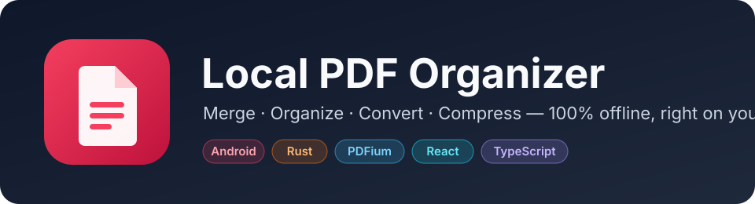
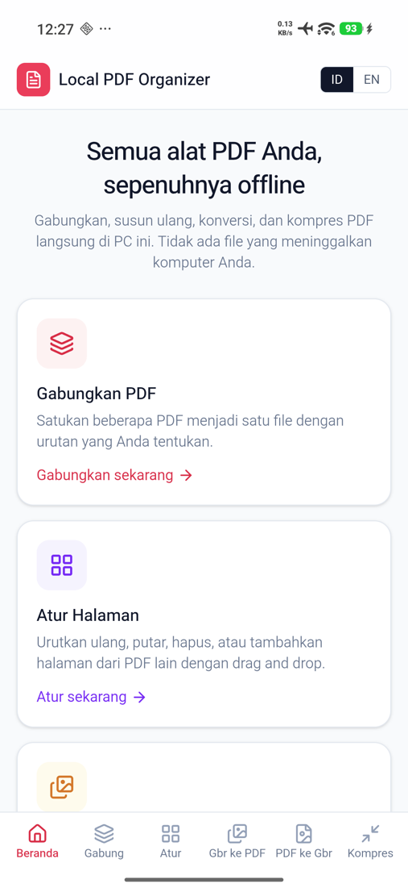
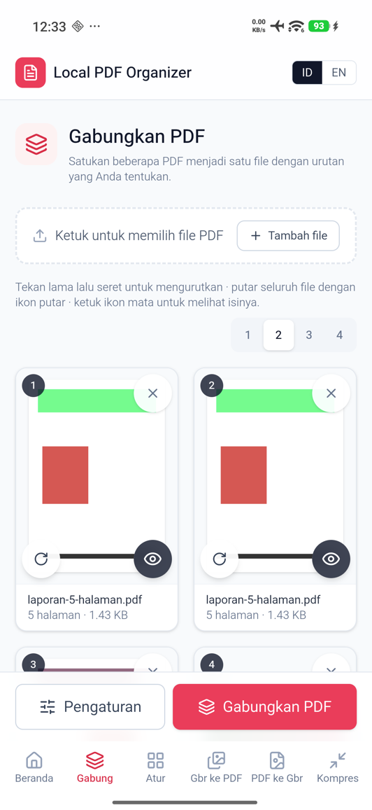
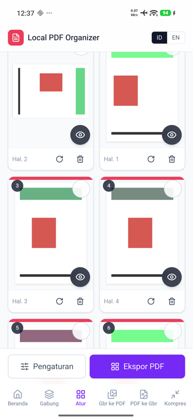
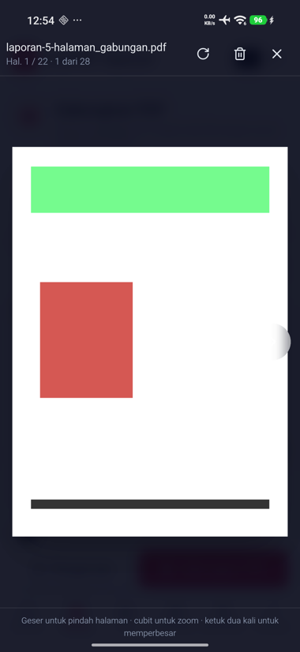
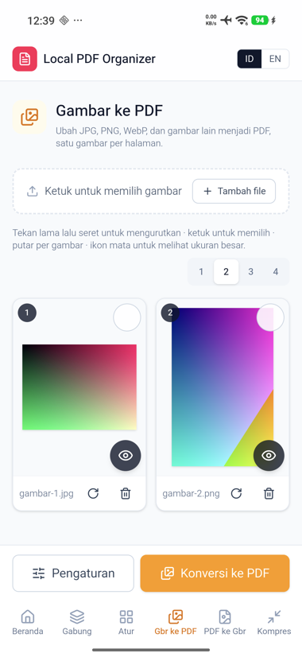
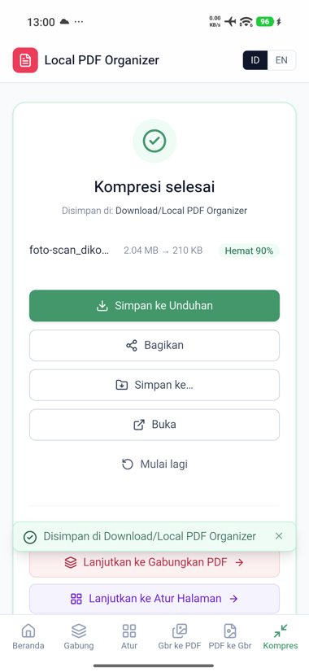

<p align="center">
  
</p>

<p align="center">
  <a href="#-features">Features</a> ·
  <a href="#-screenshots">Screenshots</a> ·
  <a href="#-install">Install</a> ·
  <a href="#-how-to-use">How to use</a> ·
  <a href="#-build-from-source">Build</a> ·
  <a href="#-roadmap">Roadmap</a>
</p>

<p align="center">
  
  
  
  
  
</p>

**Local PDF Organizer for Android** is an iLovePDF-style toolkit that runs **100% offline** on your phone.
No uploads, no account, no size limits. Your files never leave the device.

Looking for the Windows app? → [local-pdf-organizer](https://github.com/yoelkh/local-pdf-organizer)

---

## ✨ Features

| | Tool | What it does |
|:-:|---|---|
| 🧩 | **Merge PDF** | Combine several PDFs, reorder them by dragging, rotate whole files. |
| 🗂️ | **Organize Pages** | Reorder, rotate, delete, or insert pages from other PDFs. Select many at once. |
| 🖼️ | **Images → PDF** | JPG, PNG, WebP, BMP, GIF, TIFF to PDF. Rotate each image, pick page size and margins. JPEGs are embedded without re-encoding. |
| 📷 | **PDF → Images** | Render pages to PNG/JPG at 72/150/300 dpi, with page ranges and optional ZIP. |
| 🗜️ | **Compress PDF** | Three levels with a before → after size report. |

Built for touch:

- 👆 **Long-press and drag** to reorder pages; a plain swipe just scrolls.
- 🔍 **Full-screen viewer**: swipe between pages, pinch or double-tap to zoom, rotate or delete without leaving it.
- 🔢 **1–4 column switch** for thumbnails, remembered per tool.
- 💾 **Save your way**: Save to Downloads, Save to… (pick a folder), Share, or Open in another app.
- 🔗 **Continue with the result**: send the output straight into the next tool (merge → compress → convert).
- 🌐 **English** and **Bahasa Indonesia**.

---

## 📸 Screenshots

Taken on a real device (Android 16).

<p align="center">
  
  
  
  
</p>
<p align="center">
  
  
</p>

---

## 📦 Install

> **Preview build.** Tested on one phone (Xiaomi, Android 16). Not on the Play Store yet.

1. Download `LocalPDFOrganizer-x.y.z-arm64.apk` from the [Releases](../../releases) page.
2. Open it on your phone and allow "install unknown apps" for your browser or file manager.
3. Done. The app asks for **no storage permission**: it only sees files you pick.

Requirements: Android 7.0 or newer, 64-bit ARM (`arm64-v8a`), which covers nearly all current phones.

---

## 🚀 How to use

1. Pick a tool from the home screen or the bottom bar.
2. Tap the drop area and choose files in the system picker.
3. Arrange: long-press to drag, tap the eye to view a page, open **Options** for settings.
4. Tap the action button, then **Save to Downloads**, **Save to…**, **Share**, or **Open**.

Saved files land in `Download/Local PDF Organizer`.

---

## 🔒 Privacy

- Everything is processed on the device with a bundled [PDFium](https://pdfium.googlesource.com/pdfium/) engine.
- Picked files are copied into the app's private cache, and that cache is wiped every time the app starts.
- No analytics, no ads, no network calls for processing.

---

## 🛠️ Build from source

This repo holds one codebase for Windows and Android: a Rust core, a React UI, and a thin platform layer.

```powershell
npm install
rustup target add aarch64-linux-android
. .\scripts\android-env.ps1
.\scripts\android-build.ps1 -Release
```

The APK lands in `src-tauri/gen/android/app/build/outputs/apk/arm64/release/`.
Prerequisites, the JDK and symlink workarounds, and troubleshooting are in
[docs/android/BUILD.md](docs/android/BUILD.md).

```bash
cd src-tauri && cargo test      # 40 tests
npm run build                   # type-check + frontend build
npm run lint:deps               # features must not import each other
```

### How it is put together

```
┌────────────── UI: React + TypeScript + Tailwind ──────────────┐
│  src/features   one folder per tool                            │
│  src/shared     page board, viewer, i18n, platform seam        │
└───────────────────────────┬────────────────────────────────────┘
                            │ Tauri IPC (paths only, never file bytes)
┌───────────────────────────▼────────────────────────────────────┐
│  src-tauri/src/features   one folder per tool                   │
│  src-tauri/src/core       PDFium worker, lopdf, image, platform │
│  Kotlin plugin            MediaStore, FileProvider, share/open  │
└─────────────────────────────────────────────────────────────────┘
```

More detail: [docs/ARCHITECTURE.md](docs/ARCHITECTURE.md) ·
[docs/android/IO_CONTRACT.md](docs/android/IO_CONTRACT.md) ·
[docs/android/FILE_IO.md](docs/android/FILE_IO.md)

---

## 🧪 Test status

Exercised on a Xiaomi phone (HyperOS 3, Android 16); every saved file was pulled back and inspected.
All five tools, saving, sharing, the viewer, and drag-to-reorder passed.
Full table: [docs/android/BUILD.md](docs/android/BUILD.md#device-test-results-2026-10-04-xiaomi-hyperos-3--android-16).

Known issues:

- Occasionally a picked file shows up only after the next pick (seen twice, not reproducible since).
- Pinch zoom has not been verified on a device yet.
- Encrypted PDFs are not supported; interactive forms may be lost when merging.

---

## 🗺️ Roadmap

- [ ] More device coverage and a fix for the late-import issue
- [ ] `armeabi-v7a` and `x86_64` builds
- [ ] Open PDFs directly from other apps ("Open with" / share target)
- [ ] Split PDF, page numbers, watermark
- [ ] Play Store release

---

## 📄 License

[MIT](LICENSE). PDFium is bundled under the BSD-3-Clause license.
